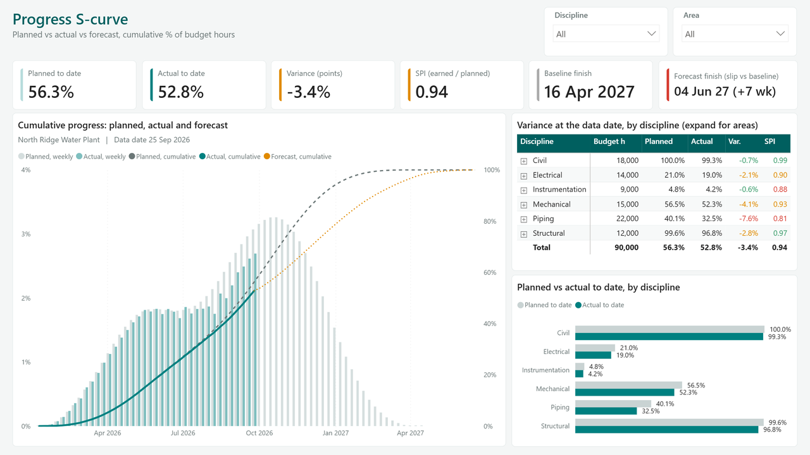

# Power BI templates for project controls

Four free Power BI report templates for the questions every project meeting asks.
Each one reads a single Excel workbook: replace the sample rows with yours, point
the `DataFile` parameter at the file, refresh.

Live page with screenshots and downloads: [babarda.com/tools/powerbi-templates](https://babarda.com/tools/powerbi-templates)

| Template | Question it answers | Folder |
|---|---|---|
| Progress S-curve | Are we ahead or behind the baseline, and where does the forecast land? | [`progress-s-curve/`](progress-s-curve) |
| Milestone tracker | Which milestones slip, by how many days, which are late? | [`milestone-tracker/`](milestone-tracker) |
| RACI matrix | Who does, owns, advises and hears about each activity, where is ownership broken? | [`raci-matrix/`](raci-matrix) |
| 3-week look-ahead | What starts, finishes or runs in the next three weeks, and what could stop it? | [`three-week-lookahead/`](three-week-lookahead) |

## Use it in three steps

1. **Download** the repository (green Code button, Download ZIP) and extract it.
   Each template folder holds a `.pbip` file, a `.Report` folder, a `.SemanticModel`
   folder and `data/sample_data.xlsx`. Keep the three `.pbip` items together.
2. **Fill the Excel.** Replace the sample rows in `data/sample_data.xlsx` with yours.
   Keep sheet names and column headers. The README sheet in the workbook explains
   every column.
3. **Point DataFile and refresh.** Open the `.pbip` in Power BI Desktop. Go to
   Home, Transform data, Edit parameters, paste the full path of your workbook in
   `DataFile` (for example `D:\Projects\Plant\sample_data.xlsx`), OK, then Refresh.

The default value of `DataFile` is `C:\PowerBI-Templates\<template>\sample_data.xlsx`.
Copy the sample there and the report refreshes without any change.

Power Query cannot read a path relative to the report, which is why the path is a
parameter. When you move or rename the workbook, edit the parameter and refresh.

## How the numbers are computed

- **Budget** = sum of Planned Hours over all weeks. **Planned % cum** = planned hours
  to week w / budget. **Actual % cum** = earned hours to week w / budget, up to the
  data date. **Forecast % cum** = (earned to the data date + forecast after it) / budget.
- **SPI** = earned hours to date / planned hours to date (earned value over planned
  value). Green from 0.95, amber from 0.90, red below.
- **Forecast finish** = first week the forecast curve reaches 99.9% of the budget.
- **Milestone slip** = (actual, or forecast while open) minus baseline, in days.
  Complete = actual filled. Late = open and forecast before the data date, or slip
  above `Late Threshold Days`. At risk = slip above 0. On track = the rest.
- **RACI check**: exactly one A and at least one R per activity.
- **Look-ahead window**: from the Monday after the data date for `Look-ahead Weeks`
  weeks. Open activities that start before the window ends are shown, overdue ones
  included.

Every measure carries a description in the model.

## Apply your brand

The templates use the KATA theme (teal, for weekly status decks). Build your own
with the [Theme Builder](https://babarda.com/tools/theme-builder), check it with
[Theme Check](https://babarda.com/tools/theme-check), then View, Themes, Browse
for themes in Power BI Desktop.

## Rebuild from source

`tools/build_data.py` writes the sample workbooks, `tools/build_pbip.py` writes
the PBIR report and TMDL model of each template (`--local` points DataFile at this
repository's own `data/` folder). Python 3.10+, `openpyxl`.

## Sample data

North Ridge Water Plant is a fictional project. Names, dates, hours and roles
are invented and identify no real company or project.

## License

MIT, Badr Abardazzou.
